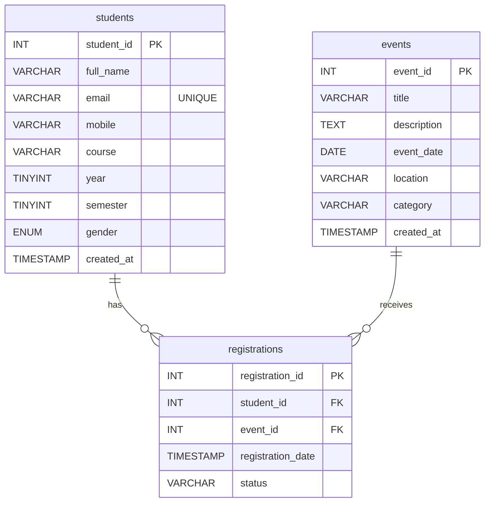

# StudentHub — ER Diagram (Practical 8)

Matches `database/studenthub_db.sql` exactly. One student can have many
registrations; one event can have many registrations; `registrations`
links the two (many-to-many between students and events).

## Mermaid source (renders automatically on GitHub)



`UNIQUE(student_id, event_id)` on `registrations` prevents the same
student being registered for the same event twice. Both foreign keys
use `ON UPDATE CASCADE` / `ON DELETE CASCADE`.

## Text version (for the printed lab file)

```text
+------------+          +-----------------+          +----------+
|  students  |          |  registrations  |          |  events  |
+------------+          +-----------------+          +----------+
| PK student_id|<---+   | PK registration_id|   +-->| PK event_id |
| full_name  |    | 1:N | FK student_id   | N:1 |   | title     |
| email UQ   |    +-----| FK event_id     |-----+   | event_date|
| mobile     |          | registration_date|       | location  |
| course     |          | status UQ(student+event)  | category  |
| year       |          +-----------------+          +----------+
| semester   |
| gender     |
+------------+
```
